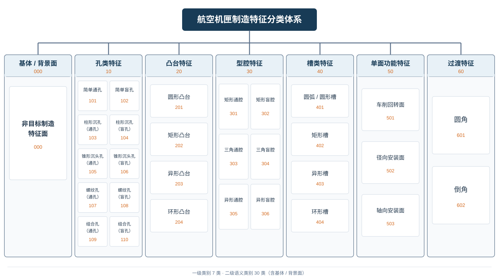

## 2.2 机匣 B-rep 图与标签定义

航空机匣的加工语义通常分布在多个相互连接的 B-rep 面上。同一类型的孔、槽或凸台可以在零件的不同位置重复出现，而单个圆柱面、平面或圆角面也不能仅凭曲面类型确定其制造特征类别。因此，数据构建需要同时解决两个问题：为每个 B-rep 面确定语义类别，以及将属于同一特征的面组织为独立实例。本节先定义机匣制造特征分类体系与两级标签，再说明 B-rep 面邻接图及图属性的构建方式。基于属性邻接图表达零件几何和拓扑关系的做法已有制造特征识别研究采用；规则与图结合的方法也为复杂局部结构的识别提供了参考。[@wu_aagnet_2024; @zhang_brepmfr_2024; @guo_hybrid_2021]

### 2.2.1 机匣制造特征分类

【已有图：图 2-1 为初始分类体系。拟补图：选取真实机匣局部，标出孔、槽、圆角和倒角的构成面，用于说明类别边界；试标后再核对图 2-1 的类别名称与代码。】

航空机匣既包含回转主体和安装基准等大面积功能面，也包含沿轴向、径向与周向分布的孔、槽、型腔及凸台。为使标注结果对应到模型中的具体面，本文暂以图 2-1 为初始分类规范，采用“一级类别—二级语义类别”的层级结构。一级类别包括基体／背景面、孔类、凸台类、型腔类、槽类、单面功能特征和过渡特征；二级类别用于逐面语义标注。该规范共定义 7 个一级类别、30 个二级语义类别，其中 000 为非目标制造特征面，余下 29 类为候选目标类别。类别表的完整性与实际覆盖情况，应在真实机匣试标及数据集统计后核定。

*图 2-1 航空机匣制造特征分类体系。图中三位数字为语义类别代码，而非特征实例编号。*

孔类特征使用 101—110 编码，按孔的基本结构以及通孔、盲孔形式区分简单孔、柱形沉孔、锥形沉头孔、螺纹孔和组合孔。凸台类使用 201—204 编码，涵盖圆形、矩形、异形与环形凸台；型腔类使用 301—306 编码，区分矩形、三角形、异形型腔及其通腔、盲腔形式；槽类使用 401—404 编码，包括圆弧／圆形槽、矩形槽、异形槽与环形槽。单面功能特征使用 501—503 编码，分别表示车削回转面、径向安装面和轴向安装面；圆角与倒角分别使用 601 和 602，作为独立的过渡特征语义类别。上述代码是标注规范的预设取值，并不意味着现有机匣样本已包含相应类别。

类别代码用于说明面所属的制造特征类型，不能代替几何判定。例如，圆柱面可能是简单孔的侧壁、沉孔的一级孔段，也可能属于回转主体；平面可能构成孔底、型腔底面或安装面。区分这些情形需要结合相邻面的曲面类型、公共边关系、开口与封闭情况以及整体局部结构。对于螺纹孔，若 CAD 模型未显式建出螺纹且没有设计标注，孔的圆柱几何本身不足以确定螺纹语义；此类标签应依据可追溯的设计信息或人工核验记录给出。

过渡面与主体特征相接时，本文按图 2-1 的定义将圆角、倒角面分别标为 601、602，不沿用相邻孔、槽或凸台的语义代码。相交特征、组合孔和共享边界面仍可能出现归属歧义，因此同一面只保留一个最终语义标签，争议面需结合设计意图与邻接结构复核。试标阶段若发现难以仅依据几何和设计资料稳定区分的类别，应记录争议及处理依据，再确定是否调整类别边界；不得为满足预设类别数而强行赋予标签。实际数据集的类别覆盖和调整情况应在第 2.4 节报告。

### 2.2.2 面级语义与实例标签

【拟补图：同一机匣局部的语义着色与实例着色对照，展示两个同类孔使用相同语义代码、不同实例编号，以及过渡特征单独编号。】

设机匣零件 $P$ 包含 $N$ 个 B-rep 面，按固定遍历顺序记为 $F(P)=\{f_1,f_2,\ldots,f_N\}$。逐面语义标签定义为

$$
y_i\in\mathcal C,\qquad i=1,2,\ldots,N,
$$

其中 $\mathcal C$ 为图 2-1 所示初始类别规范中的语义代码集合，$y_i=000$ 表示第 $i$ 个面经复核后属于非目标制造特征面。未匹配面并不自动等于背景面；对未匹配或归属有争议的区域，需先完成复核再确定最终标签。语义标签由类别定义，不能将模型内部使用的从零开始的连续类别索引与 101、201、601 等论文语义代码混用；训练时应固定并保存语义代码与连续索引之间的双向映射。

同一类别可以在一个机匣中出现多个物理上不同的特征。为区分重复特征，对每个目标面另设实例标签 $z_i$。同一完整零件内，属于同一特征实例的面具有相同的正整数 $z_i$；同一语义类别下的不同特征使用不同的实例编号。实例编号只在父零件内部唯一，不表达特征类别，也不以图 2-1 的三位语义代码充当实例编号。经复核的背景面采用 $z_i=-1$，不参与目标特征实例编号。圆角和倒角分别属于独立的语义类别 601 和 602；每个经过复核的圆角或倒角特征仍需依照其实际范围分配实例编号。

因此，两个面满足 $y_i=y_j$ 并不推出 $z_i=z_j$。例如，同一机匣上的两个简单通孔，其侧壁面都可标为 101，但分别属于两个孔实例；一个柱形沉孔的不同孔段则可共同归入该沉孔实例。对于相交特征和过渡面的实例边界，应以标注规范和人工复核结果为准，避免仅凭图连通性把相邻的不同实例合并。已有研究分别采用面级分类后的连通分组和多任务预测处理语义与实例输出，说明两者需要明确区分。[@cha_brepnet_2023; @wu_aagnet_2024]

在需要面间实例关系监督时，可以从逐面实例标签派生二值关系矩阵 $R\in\{0,1\}^{N\times N}$：

$$
R_{ij}=\begin{cases}
1,& z_i=z_j\text{ 且 }z_i,z_j\text{ 均为有效目标实例编号},\\
0,& \text{其他情况}.
\end{cases}
$$

矩阵应满足 $R_{ij}=R_{ji}$；模型训练若只使用不同面之间的关系，则排除 $i=j$ 的对角项。该矩阵由复核后的实例编号生成，不应通过语义类别相等直接推断。若沿用其他数据集现有的实例矩阵字段，还需核对该字段对背景面、自关系和复合特征的编码约定，再与本文定义建立转换关系。

标签的可靠性取决于面身份的可追溯性。语义数组、实例数组和图节点必须共享同一原始面索引；对经过 STEP 重新导出或几何编辑的模型，应重新确认面划分与索引对应后再附加标签。保留父零件标识、原始文件版本、面索引及标注修订记录，可使数据集标签、网络输出和第 4 章 CAD 系统中的面对象相互对应。

### 2.2.3 B-rep 图属性提取

【已有表：表 2-1 说明图属性与标签字段。拟补图：真实 B-rep 面、共享边与属性邻接图的一一对应，标明原始面索引和邻接属性；图中区分真实提取字段与当前占位字段。】

B-rep 通过面、边和顶点及其拓扑连接描述实体边界。本文将每个 B-rep 面映射为属性邻接图中的一个节点；当两个面共享有效拓扑边时，在对应节点之间建立邻接关系。令

$$
G(P)=(V,E,\mathbf X_V,\mathbf X_E),
$$

其中 $V=\{v_1,\ldots,v_N\}$ 与 $F(P)$ 一一对应，$E$ 为共享边诱导的面邻接关系，$\mathbf X_V$ 和 $\mathbf X_E$ 分别表示面属性与邻接边属性。空间距离相近但不共享拓扑边的两个面不构成直接图邻接。图的逻辑关系按无向邻接理解；实际存储时的边方向及重复边形式由具体图数据结构确定。类似的面邻接图表示已用于 B-rep 制造特征识别，保留了局部曲面信息和面间连接关系。[@wu_aagnet_2024; @zhang_brepmfr_2024]

本研究的 B-rep 提取器读取 STEP 几何，并按面邻接关系枚举图节点与边。编号 001 所采用的新转换流程将面 UV 网格采样、面积、曲面类型、环数和节点度数写入节点字段，将公共边网格采样、曲线类型、长度、凹凸关系及有符号连接角度写入边字段。环数由 B-rep 面的边界环提取，连接角度由公共边附近的法向变化结合凹凸关系计算。早期机匣转换脚本曾分别以常数 1 和 0 填充这两个字段，其输出不属于本次采用的训练数据。除直接邻接外，新流程还计算面间最短路径长度、路径上的边序列，以及由网格采样点估计的距离与法向夹角描述，供后续图编码使用。表 2-1 将上述属性和监督标签与新流程的 BIN 字段对应起来。

**表 2-1 B-rep 图的主要属性及标签字段**

| 数据层级 | 属性或标签 | 现有 BIN 字段 | 作用 |
| --- | --- | --- | --- |
| 面节点 | UV 网格采样、面积、曲面类型、度数及边界环数 | `x`、`y`、`z`、`a`、`l` | 描述面内几何与局部拓扑 |
| 邻接边 | 曲线网格采样、类型、长度、凹凸关系及有符号连接角度 | `x`、`t`、`l`、`c`、`a` | 描述共享边的几何与拓扑属性 |
| 面间结构 | 最短路径、路径边序列、距离、方向 | `spatial_pos`、`edges_path`、`d2_distance`、`angle_distance` | 提供直接邻接之外的成对结构信息 |
| 完整零件位置 | 径向、周向角度与轴向组成的三维柱坐标 | 新流程节点 `cylindrical_pos` | 以完整父机匣为基准形成四维周期编码，并由子图继承 |
| 标注 | 逐面语义代码及其连续类别索引、逐面实例编号 | 节点 `f`、`i` | JSON 中保留三位语义代码，转换时映射为节点 `f` 的连续索引；由 `i` 构造面间关系，测试输入不含真值标签 |

图构建与标签加载必须采用相同的面顺序。编号 001 的新转换流程检查源 STEP 文件名、面数、语义与实例数组的一致性以及语义代码映射，并在整体几何归一化前后核对面顺序；转换后把连续类别索引和实例编号分别写入 `f` 和 `i`，同时依据实例编号生成 $N\times N$ 的同实例关系矩阵。早期机匣转换脚本未执行这些完整检查，不能以其 BIN 代替新流程的输出。面划分异常、退化边或几何属性提取失败时，应记录样本和失败原因；面向真实机匣的完整标签对齐与特征有效性仍须逐件验证。
