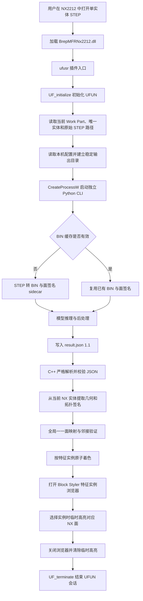

# NX2212 二次开发 API 与系统实现总结

> 适用项目：BrepMFR 机械加工特征识别系统  
> 适用版本：Siemens NX 2212、VS2019/v142、Release/x64  
> 文档用途：记录当前项目中实际使用的 NXOpen C++、UFUN、Block Styler 和相关 Windows 接口，为毕业论文的系统设计、实现方法与实验复现提供参考。  
> 说明：本文依据仓库当前 `main` 分支的实现整理。接口含义以 NX 2212 安装目录内与该版本配套的官方帮助文档为最终依据。

## 1. 系统定位与边界

本项目采用“NX 原生插件作为交互与可视化前端，Python CLI 作为识别后台”的分层架构。NX 插件不在 NX 进程中加载 Python、PyTorch、CUDA 或模型权重，而是启动独立 Python 子进程完成计算。

各层职责如下：

| 模块 | 主要职责 | 不负责的内容 |
| --- | --- | --- |
| NX2212 C++ 插件 | 获取当前打开的 STEP、读取 NX 实体和面、启动 Python、读取 JSON、跨内核面映射、着色、实例浏览和高亮 | STEP 图网络构建、神经网络推理、模型后处理 |
| Python CLI | STEP 转 BIN、BIN 缓存、模型加载、推理、实例后处理、生成标准 JSON 1.1 和 OCC 面签名 | NX Work Part 操作、NX Face Tag 获取、NX 界面显示 |
| NXOpen/UFUN | 访问 NX 会话、部件、实体、面、边、几何属性和显示对象 | 特征识别算法和跨内核匹配策略 |
| 纯 C++ 算法模块 | OCC/AAG 面到 NX 面的全局一一匹配、颜色计划和浏览器状态管理 | 直接调用 NX API |

因此，论文中可以把 NX2212 描述为系统的 CAD 交互与结果可视化平台，而不能写成“NX 完成了深度学习推理”。

## 2. 总体调用流程



主要编排函数是 `RunInferenceWorkflow()`，位于：

- `integrations/nx2212/src/plugin_runtime.cpp`

该函数依次完成配置读取、当前部件快照、Python 进程执行、JSON 读取、面映射、着色和结果展示。

## 3. 开发环境、头文件与链接库

### 3.1 已采用的构建环境

| 项目 | 当前配置 |
| --- | --- |
| NX 版本 | Siemens NX 2212 |
| 目标平台 | x64 |
| 编译工具集 | MSVC v142 |
| C++ 标准 | C++17 |
| Windows SDK | Windows 10 SDK |
| 构建配置 | Release/x64 |
| NX SDK 根目录 | `$(UGII_BASE_DIR)\UGOPEN` |

工程配置文件：

- `integrations/nx2212/BrepMFRNX2212.vcxproj`

### 3.2 主要链接库

| 链接库 | 用途 |
| --- | --- |
| `libnxopencpp.lib` | NXOpen C++ 会话、部件、几何对象、测量和显示接口 |
| `libnxopenuicpp.lib` | NXOpen UI、消息框、Listing Window 和 Block Styler |
| `libufun.lib` | UFUN 初始化和 `UF_MODL_*` 几何接口 |
| `comctl32.lib` | Windows 原生进度条控件 |

### 3.3 其他依赖

插件使用项目内置的 `nlohmann/json` 单头文件解析配置和识别结果：

- `integrations/nx2212/third_party/nlohmann/json.hpp`

实例浏览器的布局文件为：

- `integrations/nx2212/BrepMFRInstanceBrowser.dlx`

构建后，`.dlx` 和示例配置会被复制到 DLL 输出目录。插件通过 DLL 自身路径定位这些文件，不依赖 NX 的当前工作目录。

## 4. 插件入口与生命周期 API

源码位置：

- `integrations/nx2212/src/plugin_entry.cpp`
- `integrations/nx2212/include/plugin_exports.hpp`

| API/入口 | 所属 | 当前用途 | 使用要点 |
| --- | --- | --- | --- |
| `ufusr(char*, int*, int)` | NX 用户函数入口 | 用户加载并执行 DLL 时进入识别流程 | 这是插件的主入口；内部捕获所有异常，避免异常越过 DLL 边界 |
| `ufusr_ask_unload()` | NX 用户函数入口 | 返回插件卸载策略 | 当前返回 `UF_UNLOAD_IMMEDIATELY` |
| `UF_initialize()` | UFUN | 初始化 UFUN 环境 | 必须在调用 `UF_MODL_*` 前成功执行 |
| `UF_terminate()` | UFUN | 结束 UFUN 环境 | 由 RAII 对象析构时自动调用 |
| `UF_get_fail_message()` | UFUN | 把 UFUN 错误码转换为可读消息 | 用于形成具体错误诊断 |

实现中使用 `UfSession` RAII 类管理 `UF_initialize()`/`UF_terminate()`。这种写法保证正常返回或异常退出时都能释放 UFUN 会话资源。

需要注意：实例浏览器通过 `BlockDialog::Launch()` 以同步模态方式运行。浏览器关闭前 `ufusr()` 尚未返回，因此 DLL 在回调和临时高亮对象使用期间仍保持有效。

## 5. NX 会话、当前部件与实体读取

源码位置：

- `integrations/nx2212/src/nx_part_adapter.cpp`
- `integrations/nx2212/src/step_source_resolver.cpp`

### 5.1 会话与 Work Part

| API | 作用 |
| --- | --- |
| `NXOpen::Session::GetSession()` | 获取当前 NX 会话对象 |
| `Session::Parts()` | 获取部件集合 |
| `PartCollection::Work()` | 获取当前 Work Part |
| `Part::FullPath()` | 获取当前部件文件路径 |
| `NXString::GetUTF8Text()` | 将 NX 字符串读取为 UTF-8 文本 |
| `Part::Tag()` | 获取当前 Part 的会话内对象标识 |

插件首先调用 `CaptureNxCurrentPart()` 记录以下快照：

- 原始 STEP 绝对路径；
- NX Part Tag；
- NX Body Tag；
- 面数量。

Python 推理结束后，在面映射、着色和高亮前重新校验上述信息。如果用户在识别期间切换部件、改变实体或修改面数量，插件会停止后续操作，防止将识别结果显示到错误对象上。

### 5.2 实体和面遍历

| API | 作用 |
| --- | --- |
| `Part::Bodies()` | 获取当前部件的 Body 集合 |
| `Body::IsSolidBody()` | 判断是否为实体体 |
| `Body::IsSheetBody()` | 排除片体 |
| `Body::IsConvergentBody()` | 排除收敛体 |
| `Body::GetFaces()` | 获取实体包含的 NX Face 对象 |
| `Body::GetEdges()` | 获取实体包含的 NX Edge 对象 |
| `Face::Tag()` | 获取 NX Face Tag |
| `Body::Tag()` | 获取 NX Body Tag |

当前版本明确限制输入为：

1. 当前 NX 会话存在 Work Part；
2. Work Part 中恰好有一个 Body；
3. 该 Body 是精确 solid body；
4. Body 至少包含一个面；
5. Work Part 可以唯一追溯到一个仍然存在的 `.step` 或 `.stp` 文件。

### 5.3 NX 导入 STEP 后的路径处理

NX2212 直接打开 STEP 时，`Part::FullPath()` 可能返回原始 STEP，也可能返回 NX STEP 转换器生成的 `*_step.prt`。当前实现的处理逻辑如下：

- 如果 `FullPath()` 已是 `.step/.stp`，直接使用该文件；
- 如果是 `*_step.prt`，读取同目录下的 NX STEP translator 日志；
- 只有当日志能够唯一配对“源 STEP → 当前生成 PRT”时才接受；
- 不猜测同名 STEP，不自动导出 STEP，也不覆盖原模型。

这部分主要是项目自己的文件与日志解析逻辑，不属于 NX 几何 API。

## 6. NX 几何与拓扑 API

跨 CAD 内核面映射需要让 OCC/AAG 面与 NX 面具有可比较的描述。NX 侧使用 NXOpen C++ 和 UFUN 混合提取几何、曲面参数和拓扑信息。

源码位置：

- `integrations/nx2212/src/nx_part_adapter.cpp`
- `integrations/nx2212/include/face_signature.hpp`

### 6.1 面积、周长与重心

```cpp
NXOpen::Measurement* measurement = session->Measurement();
measurement->GetFaceProperties(...);
```

| API | 提取内容 |
| --- | --- |
| `Session::Measurement()` | 获取测量服务 |
| `Measurement::GetFaceProperties()` | 面积、周长、重心、半径等面属性 |

当前精度参数为 `0.999`，并拒绝 NX 返回的近似测量结果。实际参与匹配的主要属性为面积、周长和重心。

### 6.2 精确包围盒

| API | 提取内容 |
| --- | --- |
| `UF_MODL_ask_extreme()` | 沿给定方向求面的极值点 |

实现分别沿 `±X`、`±Y`、`±Z` 方向求极值，从而构造面的轴对齐包围盒。该方式避免直接依赖可能带有较大余量的近似包围盒。

### 6.3 面类型与解析曲面参数

| API | 提取内容 |
| --- | --- |
| `UF_MODL_ask_face_data()` | 面类型、基准点、方向、半径、次半径和法向方向 |

当前 UF 面类型转换如下：

| UF 类型码 | 项目曲面类型 |
| --- | --- |
| 16 | 圆柱面 `Cylinder` |
| 17 | 圆锥面 `Cone` |
| 18 | 球面 `Sphere` |
| 19 | 圆环面 `Torus` |
| 22 | 平面 `Plane` |
| 43 | B 样条面 `BSpline` |
| 其他 | `Other` |

根据不同面型，项目保留以下可比较参数：

- 平面：规范化平面原点、法向轴；
- 圆柱面：规范化轴线原点、轴向、半径；
- 圆锥面：锥顶、轴向、半锥角；
- 球面：球心、半径；
- 圆环面：中心、轴向、主半径、次半径。

由于同一无限平面或轴线可以由多个点表示，代码还对平面原点、轴线原点和轴向正负号进行规范化，避免等价几何因参数表达不同而匹配失败。

### 6.4 环、边和邻接关系

| API | 提取内容 |
| --- | --- |
| `UF_MODL_ask_face_loops()` | 获取面的环链表 |
| `UF_MODL_ask_loop_list_count()` | 统计面环数量 |
| `UF_MODL_delete_loop_list()` | 释放 UFUN 创建的环链表 |
| `Face::GetUnsortedEdges()` | 获取面的边，用于统计边数 |
| `Body::GetEdges()` | 遍历实体全部边 |
| `Edge::GetUnsortedFaces()` | 获取一条边连接的面，构建面邻接图 |

当一条边恰好连接两个有效面时，代码在两个 Face Tag 之间建立无向邻接边，并累计每个面的邻接面数量。

### 6.5 UV 采样相关接口

当前适配层仍能够提取面内采样点：

| API | 作用 |
| --- | --- |
| `UF_MODL_ask_face_uv_minmax()` | 获取面的 UV 参数范围 |
| `UF_MODL_ask_uv_points_containment()` | 判断 UV 网格点是否位于裁剪面内或边界上 |
| `UF_MODL_ask_face_props()` | 计算给定 UV 处的三维点、导数、法向和曲率半径 |

需要特别说明：**当前最终面匹配评分不再使用 `sample_points` 作为拒绝条件或代价分量。** 采样数据仍保留在签名结构和适配层中，但实际匹配依据是面类型、边数、环数、邻接数、面积、周长、重心、包围盒和解析曲面参数。论文描述当前匹配方法时，不应把采样点列为有效匹配特征。

## 7. OCC/AAG 面与 NX 面的映射

### 7.1 为什么不能直接使用面编号

Python 模型结果中的 `face_index` 是 OCC 构建 AAG 时产生的从 0 开始的面序号；NX 中用于定位显示对象的是 `NXOpen::Face::Tag()` 返回的 Face Tag。二者来自不同 CAD 内核和不同枚举过程，因此数值没有直接对应关系。

正确关系是：

```text
OCC/AAG face_index
    -> 跨内核几何与拓扑匹配
    -> NX Face Tag
    -> NXOpen::Face*
```

### 7.2 单位包围盒规范化

为了降低原点平移和单位尺度差异的影响，Python/OCC 与 NX 两侧使用相同的 `aag_unit_box` 规范化方法。

设整个实体包围盒中心为 `c`，三个方向最大跨度为 `s`，原始点为 `p`，则：

```text
p_normalized = (p - c) / s
length_normalized = length / s
area_normalized = area / s²
```

相关纯 C++ 函数位于 `face_signature.cpp`：

- `MakeUnitBoxTransform()`；
- `NormalizePoint()`；
- `NormalizeLength()`；
- `NormalizeArea()`；
- `CanonicalAxis()`；
- `CanonicalPlaneOrigin()`；
- `CanonicalAxisOrigin()`。

### 7.3 候选过滤和连续代价

源码位置：

- `integrations/nx2212/src/face_matcher.cpp`
- `integrations/nx2212/include/face_matcher.hpp`

候选面首先必须满足以下离散结构一致：

- 曲面类型一致；
- 边数一致；
- 环数一致；
- 邻接面数量一致；
- 曲面参数的存在性一致。

通过结构过滤后，再比较：

- 面积相对误差；
- 周长相对误差；
- 规范化重心距离；
- 规范化包围盒最小点和最大点距离；
- 曲面原点距离；
- 曲面轴向夹角；
- 半径、次半径和半锥角误差。

默认容差记录在 `FaceMatchOptions`：

| 参数 | 默认值 | 含义 |
| --- | ---: | --- |
| `relative_scalar_tolerance` | `1e-4` | 面积、周长和曲面标量的相对误差容限 |
| `normalized_position_tolerance` | `1e-5` | 单位包围盒坐标中的位置误差容限 |
| `axis_angle_tolerance` | `1e-6` | 轴向夹角容限，单位为弧度 |
| `ambiguity_cost_margin` | `1e-8` | 判断两个全局解是否难以区分的代价间隔 |

### 7.4 全局一一分配与拓扑验证

匹配不是逐面独立选择“最近面”，而是构造 OCC 面到 NX 面的候选代价矩阵，然后求解全局最小代价一一分配。主要过程包括：

1. 为每个 OCC 面建立满足硬约束的 NX 候选集合；
2. 使用最小代价指派求解器获得全局一一对应；
3. 将 OCC 邻接图按该映射转换为 NX Face Tag 图；
4. 要求两端邻接关系完全一致；
5. 检查是否存在代价近似相同的另一组拓扑有效解；
6. 只有完整、唯一且拓扑一致时才返回成功映射。

纯算法文件包括：

- `integrations/nx2212/src/assignment_solver.cpp`；
- `integrations/nx2212/src/face_matcher.cpp`；
- `integrations/nx2212/src/face_signature.cpp`。

这些文件不依赖 NXOpen，因此可以在不启动 NX 的情况下进行单元测试。论文中应把该部分称为“项目实现的跨 CAD 内核面映射算法”，而不是“NX 提供的面 ID 映射接口”。

## 8. Python CLI 调用、进度显示与 JSON 读取

### 8.1 本机配置

插件从 DLL 同目录读取：

```text
BrepMFRNx2212.config.json
```

主要配置字段包括：

- `python_executable`：Python/Conda 环境的解释器；
- `inference_script`：`tools/infer_step.py`；
- `checkpoint`：模型权重；
- `output_root`：识别输出根目录；
- `device`：推理设备；
- `affinity_threshold`：实例关系阈值。

配置与 `result.json` 均由 `nlohmann::json` 解析。代码会检查必需字段、数据类型、绝对路径、文件存在性、数值范围和 JSON schema，而不是仅依赖字段是否出现。

### 8.2 Windows 进程接口

源码位置：

- `integrations/nx2212/src/inference_process.cpp`
- `integrations/nx2212/src/inference_command.cpp`
- `integrations/nx2212/src/progress_window.cpp`

| Windows API | 当前用途 |
| --- | --- |
| `CreateFileW()` | 创建并覆盖本次 `run.log`，接收子进程输出 |
| `CreateProcessW()` | 直接启动指定 Python，不经过 `cmd.exe` |
| `WaitForSingleObject()` | 每 100 ms 检查 Python 是否结束 |
| `GetExitCodeProcess()` | 获取 Python 退出码 |
| `GetEnvironmentStringsW()` / `FreeEnvironmentStringsW()` | 构造隔离后的子进程环境块 |
| `CloseHandle()` | 释放进程、线程和文件句柄 |
| `GetModuleFileNameW()` | 获取插件 DLL 目录 |
| `GetForegroundWindow()` | 获取进度窗口的所有者窗口 |

子进程使用 `CREATE_NO_WINDOW` 启动，标准输出和标准错误均重定向到 `run.log`。插件对命令行参数进行 Windows 规则转义，并显式设置仓库工作目录。

为避免 NX 环境污染 Python/OCC/深度学习依赖，子进程环境会移除 NX 注入的 `UGII_*`、`UGS_*`、`PYTHONHOME` 和 `PYTHONPATH` 等变量，并优先使用配置 Python 环境的目录。

### 8.3 进度窗口

进度窗口使用 Win32 API 和 `comctl32`，并不是 NXOpen Block Styler 窗口。主要接口包括：

- `CreateWindowExW()`：创建窗口、文本和进度条控件；
- `PBM_SETMARQUEE`：显示不确定进度条；
- `PeekMessageW()`、`TranslateMessage()`、`DispatchMessageW()`：在等待 Python 时保持窗口响应；
- `SetWindowTextW()`：更新真实阶段和已用时间；
- `ShowWindow()`、`UpdateWindow()`：显示和刷新窗口。

Python CLI 使用 `BREPMFR_PROGRESS:<stage>` 行报告真实阶段，C++ 定期读取 `run.log` 并更新界面。因此进度条只表示“正在处理”，阶段文本才反映当前真实工作内容。

在启动外部进程期间，`NXOpen::UI::LockAccess()` 暂时锁定 NX 主界面，结束后由 RAII 对象调用 `UI::UnlockAccess()`，防止用户在推理期间切换或修改当前部件。

### 8.4 JSON 结果契约

源码位置：

- `integrations/nx2212/src/result_reader.cpp`
- `integrations/nx2212/src/result_formatter.cpp`

当前兼容规则：

- JSON 1.0：读取并显示文字识别结果，不进行 NX 面映射或着色；
- JSON 1.1：在原有识别结果之外读取 `face_mapping`，允许面映射和可视化；
- Python 退出码和 JSON `status` 必须一致；
- 每次启动前删除旧 `result.json`，防止 Python 失败后误读历史结果；
- 输入 STEP 路径、面数量、实例 ID、面索引、置信度和签名字段均严格校验。

输出目录由 STEP 文件名和规范化绝对路径哈希共同确定。该路径哈希用于隔离同名文件的输出目录，BIN 是否真正有效仍由 Python 端的 STEP 内容指纹和转换配置校验决定。

## 9. NX 面着色与失败回滚

源码位置：

- `integrations/nx2212/src/color_plan.cpp`
- `integrations/nx2212/src/nx_coloring.cpp`

### 9.1 颜色计划

`BuildColorPlan()` 将：

```text
feature instance_id
    -> OCC face_index 集合
    -> NX Face Tag 集合
    -> NX color_index
```

转换成具体的面着色任务。当前每个实例使用一个 NX 颜色索引，颜色索引范围为 1～216，因此单次结果最多支持 216 个不同颜色的特征实例。

颜色计划在调用 NX 显示 API 前检查：

- 映射覆盖全部识别面；
- OCC 面索引和 NX Face Tag 均唯一；
- 实例 ID 合法且唯一；
- 同一面不会属于多个实例；
- 同一实例只有一种颜色。

### 9.2 着色 API

| API | 作用 |
| --- | --- |
| `Session::DisplayManager()` | 获取显示管理器 |
| `DisplayManager::NewDisplayModification()` | 创建批量显示修改对象 |
| `DisplayModification::SetApplyToAllFaces(false)` | 只修改明确传入的面 |
| `DisplayModification::SetNewColor()` | 设置新的 NX 颜色索引 |
| `DisplayModification::Apply()` | 批量应用到 `DisplayableObject` 集合 |
| `DisplayableObject::Color()` | 读取面原有颜色，供显式恢复 |

相同颜色的面被分组后一次性传给 `Apply()`，减少重复创建显示修改对象的开销。

### 9.3 原子性与撤销

| API | 作用 |
| --- | --- |
| `Session::SetUndoMark()` | 在着色前建立可见撤销标记 |
| `Session::UndoToMark()` | 着色过程失败时回到标记 |
| `Session::DoesUndoMarkExist()` | 检查标记是否仍存在 |
| `Session::DeleteUndoMark()` | 清理失败流程中的撤销标记 |

“原子着色”的含义是：只有完整面映射和完整颜色计划均成功后才开始修改 NX；如果任一颜色组应用失败，则先调用 `UndoToMark()`，随后再按着色前记录的颜色显式恢复。最终结果要么全部着色成功，要么不保留部分着色。

## 10. Block Styler 特征实例浏览器

源码与界面文件：

- `integrations/nx2212/src/nx_instance_browser.cpp`
- `integrations/nx2212/src/instance_browser.cpp`
- `integrations/nx2212/BrepMFRInstanceBrowser.dlx`

### 10.1 对话框创建与回调

| API | 作用 |
| --- | --- |
| `NXOpen::UI::GetUI()` | 获取 NX UI 服务 |
| `UI::CreateDialog()` | 从 `.dlx` 创建 Block Styler 对话框 |
| `BlockDialog::AddInitializeHandler()` | 注册控件初始化回调 |
| `BlockDialog::AddDialogShownHandler()` | 注册窗口显示后的初始化回调 |
| `BlockDialog::AddUpdateHandler()` | 处理上一页、下一页和查看完整结果按钮 |
| `BlockDialog::AddOkHandler()` | 处理确定操作 |
| `BlockDialog::AddCloseHandler()` | 处理关闭操作 |
| `BlockDialog::Launch()` | 启动模态实例浏览器 |
| `NXOpen::make_callback()` | 将成员函数绑定为 NX 回调 |

### 10.2 控件查找与属性设置

| API | 作用 |
| --- | --- |
| `BlockDialog::TopBlock()` | 获取对话框顶层组合块 |
| `CompositeBlock::FindBlock()` | 按 `.dlx` 中的 Block ID 查找控件 |
| `UIBlock::GetProperties()` | 获取控件属性表 |
| `PropertyList::SetString("Value", ...)` | 设置单行字符串控件 |
| `PropertyList::SetStrings("Value", ...)` | 设置多行字符串控件 |
| `UIBlock::SetEnable()` | 启用或禁用控件 |
| `UIBlock::SetShow()` | 显示或隐藏控件 |

多行文本控件的 `Value` 属性类型是字符串数组，因此必须使用 `SetStrings()`，不能使用 `SetString()`。这也是 Block Styler 开发中容易出现“Incorrect property type”错误的地方。

### 10.3 Tree 实例列表

| API | 作用 |
| --- | --- |
| `Tree::SetOnSelectHandler()` | 注册实例选择回调 |
| `Tree::InsertColumn()` | 创建实例、特征类型、面数和置信度列 |
| `Tree::SetColumnSortable()` | 禁止列排序，保持实例顺序稳定 |
| `Tree::SetColumnResizePolicy()` | 设置固定列宽或随窗口缩放 |
| `Tree::CreateNode()` | 创建实例节点 |
| `Tree::InsertNode()` | 把节点插入当前 Tree |
| `Node::SetColumnDisplayText()` | 设置节点各列文本 |
| `Tree::RootNode()` / `Tree::DeleteNode()` | 清理并重建当前页节点 |
| `Tree::Redraw(false/true)` | 批量刷新时暂停和恢复重绘 |

一个重要的调用顺序是：先用 `InsertNode()` 把节点加入 Tree，再调用 `SetColumnDisplayText()` 设置其他列。对尚未插入树中的节点操作会触发“Node is not inserted/available in tree”错误。

浏览器每页显示 50 个实例。只有实例数超过 50 时才显示分页区；切换页面会清除当前临时高亮，防止页面状态与图形窗口不一致。

### 10.4 临时高亮

| API | 作用 |
| --- | --- |
| `Face::Highlight()` | 为当前选中实例的面增加 NX 临时高亮 |
| `Face::Unhighlight()` | 清除临时高亮 |

浏览器采用“基础实例颜色保持不变，当前实例额外临时高亮”的交互方式：

1. 选择新实例前先清除上一个实例的高亮；
2. 根据已完成的 `instance_id -> NX Face Tag` 映射找到面对象；
3. 对本实例全部面调用 `Highlight()`；
4. 切页、确定、关闭或发生异常时调用 `Unhighlight()`；
5. 临时高亮清除后，识别阶段设置的基础颜色仍保留。

### 10.5 信息窗口与消息框

| API | 作用 |
| --- | --- |
| `Session::ListingWindow()` | 获取 NX 信息窗口 |
| `ListingWindow::Open()` | 打开信息窗口 |
| `ListingWindow::WriteFullline()` | 输出完整文字识别结果 |
| `UI::NXMessageBox()` | 获取 NX 消息框服务 |
| `NXMessageBox::Show()` | 显示成功摘要或错误信息 |
| `NXOpen::NXString(..., NXString::UTF8)` | 把 UTF-8 中文文本传给 NXOpen |

当映射和着色成功时，插件直接打开实例浏览器；“查看完整结果”按钮把完整结果写入 Listing Window。若 JSON 仅支持文字结果或面映射失败，则不打开浏览器，而是使用 Listing Window 和消息框显示诊断。

## 11. API 与项目模块对应表

| 模块文件 | NX/系统接口 | 模块职责 |
| --- | --- | --- |
| `plugin_entry.cpp` | `ufusr`、`ufusr_ask_unload`、`UF_initialize`、`UF_terminate` | 插件入口与 UFUN 生命周期 |
| `nx_plugin_host.cpp` | `Session`、`UI`、`ListingWindow`、`NXMessageBox`、`LockAccess` | NX 服务适配、消息显示和流程桥接 |
| `nx_part_adapter.cpp` | `Part`、`Body`、`Face`、`Edge`、`Measurement`、`UF_MODL_*` | 当前部件校验和 NX 面签名提取 |
| `step_source_resolver.cpp` | 无 NX 几何 API | 从 Work Part 路径和 translator 日志还原原始 STEP |
| `inference_process.cpp` | Win32 `CreateProcessW` 等 | 独立 Python 进程、日志、环境隔离和等待 |
| `progress_window.cpp` | Win32 窗口和进度条 API | 识别阶段和耗时显示 |
| `result_reader.cpp` | `nlohmann::json` | JSON 1.0/1.1 严格解析与校验 |
| `face_matcher.cpp` | 无 NX API | 跨内核候选评分、全局匹配和拓扑验证 |
| `assignment_solver.cpp` | 无 NX API | 最小代价一一指派 |
| `color_plan.cpp` | 无 NX API | 将识别实例转换为颜色任务 |
| `nx_coloring.cpp` | `DisplayModification`、Undo Mark | NX 面批量着色与失败回滚 |
| `instance_browser.cpp` | 无 NX API | 浏览器数据模型、分页和选择状态 |
| `nx_instance_browser.cpp` | Block Styler、`Highlight`、`Unhighlight` | 实例浏览器和 NX 临时高亮 |
| `result_formatter.cpp` | 无 NX API | 中文特征名和显示文本格式化 |

这种划分使 NX 相关代码集中在薄适配层，面匹配、指派、颜色计划、分页和结果格式化可以脱离 NX 运行并自动测试。

## 12. 论文表述建议

### 12.1 可用于系统总体设计的表述

> 为避免在 NX 主进程中直接加载深度学习框架及其复杂运行时依赖，系统采用 NXOpen C++ 插件与外部 Python 推理进程相结合的松耦合架构。NX 插件负责获取当前加工零件、编排推理任务、解析标准 JSON 结果以及完成特征面着色和交互式浏览；STEP 到图数据的转换、神经网络推理和实例后处理均由独立 Python CLI 完成。该设计隔离了 NX 与 Python/OCC/PyTorch 的运行环境，降低了 DLL 冲突风险，同时保留了 CAD 场景内的原生交互能力。

### 12.2 可用于几何信息提取的表述

> NX 侧通过 NXOpen C++ 与 UFUN 混合接口读取当前单实体零件。利用 `Measurement::GetFaceProperties` 获取面积、周长和重心，利用 `UF_MODL_ask_extreme` 构造精确包围盒，利用 `UF_MODL_ask_face_data` 提取曲面类型及解析参数，并通过面—边连接关系建立邻接图。所有位置和尺度量在统一的实体单位包围盒中规范化，以降低平移和单位差异对跨内核比较的影响。

### 12.3 可用于跨内核面映射的表述

> 模型输出的 OCC/AAG 面索引与 NX Face Tag 不具有数值同一性。为将识别结果准确回写到 NX，本文构建由曲面类型、边数、环数、邻接数、面积、周长、重心、包围盒及解析曲面参数组成的跨内核面签名。算法先利用离散属性筛选候选，再以连续几何误差建立代价矩阵，求解全局一一指派，并使用完整面邻接图验证映射。仅当映射完整、唯一且拓扑一致时才允许着色，从而避免逐面贪心匹配造成的重复映射或错误高亮。

### 12.4 可用于可视化交互的表述

> 在映射成功后，插件通过 `DisplayModification` 按特征实例对 NX 面进行批量着色，并利用 Undo Mark 和显式颜色恢复实现失败回滚。基于 Block Styler 构建特征实例浏览器，列表展示实例编号、中文特征类型、面数量和置信度；用户选择实例时调用 `Face::Highlight` 对其包含的面进行临时高亮，关闭窗口后调用 `Face::Unhighlight` 清除临时状态，同时保留基础识别颜色。

### 12.5 需要避免的错误表述

| 不准确表述 | 建议改写 |
| --- | --- |
| “NX 完成模型推理” | “NX 插件启动独立 Python CLI 完成模型推理” |
| “模型输出 NX 面 ID” | “模型输出 OCC/AAG 面索引，插件将其映射为 NX Face Tag” |
| “调用 NX API 自动完成跨内核面匹配” | “项目基于 NX API 提取签名，并用自研纯 C++ 算法完成匹配” |
| “面编号在 STEP、OCC 和 NX 中保持一致” | “不同 CAD 内核的面身份不直接一致，需要显式映射” |
| “进度条表示推理完成比例” | “当前为不确定进度条，真实阶段由 Python 日志协议报告” |
| “采样点用于最终面匹配” | “当前实现保留采样数据，但最终评分不使用采样点” |

## 13. 当前限制与可扩展方向

### 13.1 当前限制

- 仅支持 NX2212、Release/x64 和当前已验证的 v142 工具链；
- 输入必须是未经修改的、可追溯到原始 STEP 的单精确实体；
- 识别过程中不能切换 Work Part 或修改拓扑；
- 不自动把当前 NX 建模结果导出为 STEP；
- JSON 1.0 只能显示文字，JSON 1.1 才能进行面映射和着色；
- 只有完整一一映射才允许着色，不支持“能匹配多少就显示多少”；
- 每个实例占用一个 NX 颜色索引，当前颜色计划上限为 216 个实例；
- Python 每次以独立进程启动，仍包含解释器和模块冷启动开销；
- 临时高亮以实例为单位，不支持同时选择多个实例。

### 13.2 后续可扩展方向

- 增加当前 NX Part 到临时 STEP 的受控导出流程，使编辑后的 NX 模型也能识别；
- 将 Python 后台改为常驻服务，减少重复启动和模型加载时间；
- 增加多实体选择和装配环境下的对象范围管理；
- 增加实例筛选、按类型分组、搜索和多选高亮；
- 将识别结果写入 NX 属性、PMI 或专用结果对象；
- 为不同 NX 版本建立独立构建配置并开展兼容性验证；
- 在不降低正确性的前提下，移除未参与最终匹配的采样点提取，以减少签名计算成本和数据体积。

## 14. 复现与验证建议

论文实验或软件验收应至少记录：

1. NX 版本、编译工具集、目标平台和 Python 环境；
2. STEP 文件哈希、模型 checkpoint 和 CLI 参数；
3. BIN 缓存命中状态；
4. STEP→BIN、模型 pipeline、Python 进程总耗时和面映射耗时；
5. 输入面数量、映射面数量和特征实例数量；
6. `result.json` schema 版本；
7. 映射是否完整、是否通过拓扑验证；
8. NX 中实际着色实例数量；
9. 同一 STEP 首次运行与缓存命中运行的结果一致性；
10. 异常输入下是否保持零部分着色。

当前已用于现场验证的黄金样例包含 41 个面和 9 个特征实例，成功界面应显示 41/41 面映射、9 个着色实例，并能够在实例浏览器中逐项高亮。

## 15. 相关代码与设计文档索引

### 15.1 使用与构建说明

- `integrations/nx2212/README.md`
- `integrations/nx2212/BrepMFRNX2212.vcxproj`
- `integrations/nx2212/BrepMFRNx2212.config.example.json`

### 15.2 主要实现

- `integrations/nx2212/src/plugin_entry.cpp`
- `integrations/nx2212/src/plugin_runtime.cpp`
- `integrations/nx2212/src/nx_plugin_host.cpp`
- `integrations/nx2212/src/nx_part_adapter.cpp`
- `integrations/nx2212/src/inference_process.cpp`
- `integrations/nx2212/src/result_reader.cpp`
- `integrations/nx2212/src/face_matcher.cpp`
- `integrations/nx2212/src/assignment_solver.cpp`
- `integrations/nx2212/src/color_plan.cpp`
- `integrations/nx2212/src/nx_coloring.cpp`
- `integrations/nx2212/src/instance_browser.cpp`
- `integrations/nx2212/src/nx_instance_browser.cpp`

### 15.3 设计记录

- `docs/superpowers/specs/2026-08-24-nx2212-plugin-bootstrap-design.md`
- `docs/superpowers/specs/2026-08-24-nx-python-json-integration-design.md`
- `docs/superpowers/specs/2026-08-25-nx-current-step-face-mapping-design.md`
- `docs/superpowers/specs/2026-08-27-nx-instance-browser-design.md`

## 16. 引用与使用注意事项

本文是项目实现总结，可以作为论文写作提纲和实现证据，但不能替代正式文献引用。论文中涉及 NXOpen、UFUN 或 Block Styler 接口定义时，建议引用与 NX 2212 配套的 Siemens 官方开发帮助；涉及 PyTorch、Open CASCADE、图神经网络或特征识别模型时，应分别引用对应软件文档或研究论文。

写作时应区分三类证据：

1. **官方 API 能力**：NXOpen/UFUN 提供的会话、几何、显示和 UI 接口；
2. **本项目设计选择**：外部 Python 进程、JSON 1.1、缓存策略和错误处理；
3. **本项目算法贡献**：规范化跨内核面签名、全局一一指派、拓扑验证和原子可视化流程。

这种区分既能准确说明 NX 二次开发的作用，也能清楚突出系统集成和跨内核面映射部分的自主实现。
